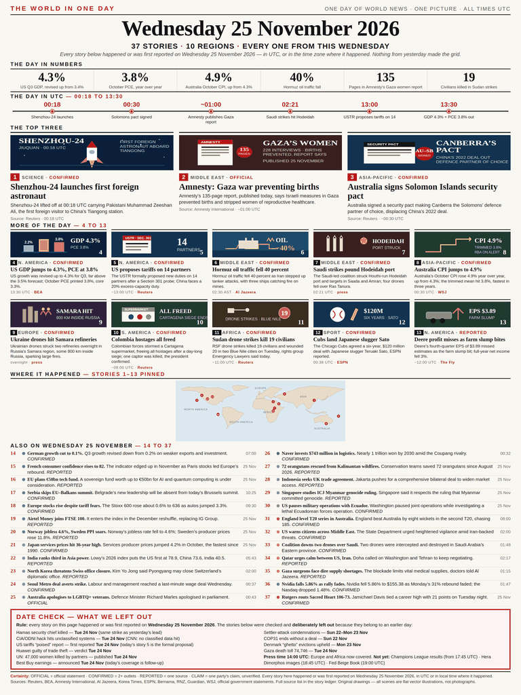

# The World in One Day — Wednesday 25 November 2026

[](https://make.fun/bounty/news-image-20261125)
[](https://make.fun/bounty/news-image-20261125)
[](https://make.fun/bounty/news-image-20261125)

One image that sums up the world's news of **Wednesday 25 November 2026** — 37 stories from 10 regions, every one of them happened or was first reported that day. Built for the [make.fun news-image bounty](https://make.fun/bounty/news-image-20261125) ($100, top 50 share).



## What's in the picture

- **Masthead** — the day in giant type: Wednesday 25 November 2026.
- **The day in numbers** — 4.3% (US Q3 GDP, second estimate, revised up from 3.4%), 3.8% (October PCE, year over year), 4.9% (Australia October CPI, up from 4.3%), 40% (Hormuz oil traffic fall), 135 (pages in Amnesty's Gaza report), 19 (civilians killed in Sudan strikes).
- **The day in UTC** — a 6-event timeline from the first launch to the 13:30 UTC data release, 00:18–13:30.
- **The top three** — Shenzhou-24 launches with the first foreign astronaut aboard Tiangong, Amnesty's Gaza report, Australia's Solomon Islands security pact — each with a flat vector illustration.
- **More of the day (4–13)** — ten small cards with full-scene illustrations (US GDP/PCE, the USTR tariff proposal, Hormuz, Hodeidah strikes, Australia CPI, Samara refineries, Colombia hostages, Sudan strikes, Cubs' Sato, Deere), then a pinned world map and the full 14–37 list.
- **DATE CHECK** — the red box lists the stories deliberately left out because they belong to an earlier day (the Hamas security chief strike, the CIA/ODNI hack, the US tariff "poised" report, the Huawei verdict, the UN femicide brief — all Tuesday 24 November), and explains that the 25 November tariff proposal is a distinct formal event, not a repeat. Press time 14:00 UTC: Europe and Africa now covered; Champions League results, Hera Dimorphos images and the Fed Beige Book had not happened yet.
- **Sources** — BEA, Reuters, Amnesty International, Al Jazeera, Korea Times, ESPN, Bernama, RNZ, Guardian, WSJ, official government statements. The full source ledger is in `story-ledger.md`.

## V2 changes (vs V1: 27 stories, 8 regions)

Ten more stories and two more regions (Europe, Africa) from the day's later news — the 13:30 UTC BEA release (GDP 4.3%, PCE 3.8%), the formal USTR tariff proposal, Europe's working day and Sudan. The same template, with one variable changed on purpose: **legibility at judged size**. The parallel 24 November edition's round-3 result showed its 43-story V2 scoring 61.0%, still 4.7 points below the top-50 line, with winners clustering at 32–38 stories — at 768×1024 (possibly a 300px thumbnail) 43 stories means unreadably small type. So this V2 cuts the six weakest verified items and grows the type and map back (also-on 21px, map 280px, timeline 104px, lead illustrations 162px): 37 stories, 10 regions, 13 full-scene illustrations.

## How it was made

`broadsheet.html` is the source (fixed 2400×3200 canvas, editorial broadsheet style); `render.mjs` renders it to PNG with Playwright/Chromium. The submitted `entry.png` is the same image downscaled to 768×1024 so it fits the gate (at most 1 MiB, at most 1024×1024 pixels). `story-ledger.md` records every story with its source and verification note, including the three researcher claims re-checked and corrected during the build and the six items cut for legibility.

## Run it

```sh
node main.ts
```

`main.ts` (Node 22, standard library only) validates `entry.png` — PNG magic, dimensions within 1024×1024, size within 1 MiB, IEND chunk present — then copies it to `/output/entry.png` (or `$MAKEFUN_OUTPUT_DIR/entry.png` outside the grader). The output is byte-identical to `entry.png`.

## License

MIT — see `LICENSE`.
